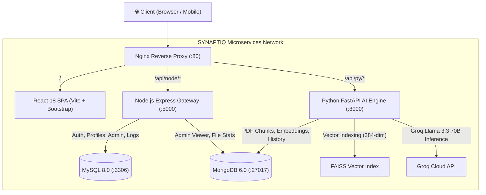

<div align="center">

# 🎓 SYNAPTIQ
### Next-Generation AI Campus Copilot & Academic Intelligence Platform

[](https://www.docker.com/)
[](https://kubernetes.io/)
[](https://react.dev/)
[](https://nodejs.org/)
[](https://fastapi.tiangolo.com/)
[](https://www.mysql.com/)
[](https://www.mongodb.com/)
[-F05A28)](https://groq.com/)
[](LICENSE)

*A cloud-native, microservices-driven academic copilot unifying lecture Retrieval-Augmented Generation (RAG), personalized educational video recommendations, dynamic timetable management, interactive assessments, and an administrative governance portal.*

---

[Key Features](#-key-features) •
[Architecture](#-architecture) •
[Quick Start (Docker)](#-quick-start-with-docker-recommended) •
[Kubernetes Deployment](#-kubernetes-deployment) •
[Local Development](#-manual-local-development) •
[Admin Portal](#-admin-portal--governance) •
[API Reference](#-api-endpoints)

</div>

---

## 🌟 Key Features

### 🤖 1. AI Campus Copilot & Llama 3.3 LLM
- Ultra-low latency responses powered by **Groq Cloud** running `llama-3.3-70b-versatile`.
- Intelligent conversational assistant tailored for academic queries, syllabus clarifications, code debugging, and concept explanation.

### 📚 2. Syllabus & Lecture Notes RAG (Retrieval-Augmented Generation)
- Upload syllabus documents and course lecture PDFs (`pypdf` extraction).
- Vectorization using Hugging Face's `sentence-transformers/all-MiniLM-L6-v2` into 384-dimensional dense semantic vector space.
- High-performance vector similarity search using **Facebook AI Similarity Search (FAISS)**.
- Grounded contextual synthesis: answers provide direct citations from uploaded course materials.

### 📺 3. Intelligent Video Recommendations Engine
- Contextual vector matching that suggests curated YouTube educational lectures based on course syllabus topics and assessment performance.
- Learning history tracking to identify student topic gaps and automatically generate targeted study queues.

### 📝 4. ExamSprint Assessment & Weak-Area Diagnostic
- Interactive dynamic quizzes and knowledge checks.
- Granular performance tracking persisted in MongoDB to map student strengths and weaknesses.

### 🛡️ 5. Comprehensive Admin Portal & Governance
- **Live Database Explorer**: View relational MySQL records (Users, Student Profiles, Audit Logs) and MongoDB document collections directly from the UI.
- **Student User Management**: Approve/reject new registrations, activate/suspend accounts, filter by role/department.
- **Login Security & Audit Trails**: Monitor authentication attempts, timestamps, client IP addresses, and User-Agents.
- **Campus Announcements**: Publish, pin, edit, and toggle priority announcements shown across student dashboards.
- **Direct & Broadcast Notifications**: Send targeted alerts to individual student emails or broadcast system-wide updates.
- **System Feature Toggles**: Control maintenance mode, registration locks, and mandatory approval workflows on the fly.

### 👤 6. Student Profile & Identity Management
- Academic identity tracker (Registration Number, Department, Academic Year, Phone).
- Client-side auto-compressed avatar upload with HTML5 canvas (resizes high-res images up to 100MB into crisp, lightweight avatars).

---

## 🏛️ Architecture



---

## 🚀 Quick Start with Docker (Recommended)

Run the entire platform (Databases, AI backends, Frontend, and Reverse Proxy) with **a single command**. No local Python, Node.js, MySQL, or MongoDB installations required.

### Prerequisites
- [Docker Desktop](https://www.docker.com/products/docker-desktop/) (Windows / macOS / Linux)

### 1. Clone the Repository
```bash
git clone https://github.com/your-username/synaptiq-ai-campus.git
cd synaptiq-ai-campus
```

### 2. Configure Environment (Optional)
Create or review the `.env` file in the root directory:
```env
# Database Credentials
MYSQL_PASSWORD=Gunal@15
JWT_SECRET=synaptiqsecret2026

# AI LLM API Key (Groq Cloud)
GROQ_API_KEY=gsk_your_groq_api_key_here
```

### 3. Spin Up the Stack
```bash
docker compose up -d
```

### 4. Open in Browser
Visit: **[http://localhost](http://localhost)**

| Service | Public URL | Description |
| :--- | :--- | :--- |
| **Frontend Portal** | [http://localhost/](http://localhost/) | Main student & admin application |
| **Node.js Gateway** | [http://localhost/api/node/system-status](http://localhost/api/node/system-status) | Health & system governance |
| **FastAPI Swagger Docs**| [http://localhost/api/py/docs](http://localhost/api/py/docs) | Interactive OpenAPI documentation |
| **MySQL Service** | `localhost:3307` | Relational database access |
| **MongoDB Service** | `localhost:27017` | Document database access |

---

## ☸️ Kubernetes Deployment

SYNAPTIQ includes a full suite of declarative Kubernetes manifests in [`k8s/`](file:///d:/ai%20campus/k8s/) utilizing Kustomize.

### 1. Enable Kubernetes
Enable Kubernetes in **Docker Desktop** (Settings $\rightarrow$ Kubernetes $\rightarrow$ Enable Kubernetes) or connect to your cloud cluster (AWS EKS, GKE, AKS, DigitalOcean, or K3s).

### 2. Deploy the Entire Stack
```bash
kubectl apply -k k8s
```

This single command provisions:
- Dedicated **`synaptiq`** namespace
- ConfigMaps for environment settings and MySQL auto-initialization
- Kubernetes Secrets for database passwords and JWT secrets
- PersistentVolumeClaims (PVCs) for MySQL data, MongoDB data, and uploaded PDF files
- Deployments and ClusterIP Services for all 5 services
- Ingress routing with automatic SSL annotations

### 3. Check Pod Status
```bash
kubectl get pods -n synaptiq
```

### 4. Access the Application
```bash
kubectl port-forward -n synaptiq svc/synaptiq-frontend 8080:80
```
Then navigate to **[http://localhost:8080](http://localhost:8080)**.

---

## 💻 Manual Local Development

If you prefer to run services individually for active development:

### 1. Start Databases via Docker
```bash
docker compose up -d synaptiq-mysql synaptiq-mongodb
```

### 2. Start Node.js Backend
```bash
cd backend
npm install
npm run dev
# Running on http://localhost:5000
```

### 3. Start Python FastAPI AI Backend
```bash
cd backend
python -m venv venv
# Windows:
.\venv\Scripts\activate
# Linux/macOS:
source venv/bin/activate

pip install -r requirements.txt
uvicorn main:app --host 0.0.0.0 --port 8000 --reload
# Running on http://localhost:8000
```

### 4. Start React Frontend
```bash
cd frontend
npm install
npm run dev
# Running on http://localhost:5173
```

*(The frontend automatically detects port 5173 and routes calls directly to `localhost:5000` and `localhost:8000`).*

---

## 🛡️ Admin Portal & Governance

To access the administrator workspace:
1. Log in with an administrator account (default seed admin: `sivagunal15@gmail.com`).
2. Navigate to **Admin Portal** from the sidebar navigation.

### Available Admin Controls:
- **System Health & Governance**:
  - `Maintenance Mode`: Gracefully restricts student access while allowing admins to perform upgrades.
  - `Allow Public Signups`: Toggle open registration on/off.
  - `Require Admin Approval`: Put new student registrations into pending state until reviewed.
  - `Announcement Banner`: Toggle campus-wide broadcast banner visibility.
- **User Governance**: Approve, reject, promote to admin, or delete student accounts.
- **Campus Announcements**: Post global or department-specific bulletins.
- **Direct Student Notifications**: Push instant notification records to any student email.
- **Database Explorer**: Direct JSON and tabular inspection of MySQL tables and MongoDB collections.

---

## 📡 API Endpoints

### Node.js Gateway (`/api/node`)
| Method | Endpoint | Description | Auth |
| :--- | :--- | :--- | :--- |
| `POST` | `/login` | Authenticate user & issue JWT | Public |
| `POST` | `/signup` | Register new student account | Public |
| `GET` | `/system-status` | Get governance settings & status | Public |
| `GET` | `/profile/:email` | Get student academic profile | Bearer JWT |
| `POST` | `/profile` | Save or update student profile | Bearer JWT |
| `GET` | `/notifications` | Retrieve user notification inbox | Bearer JWT |
| `GET` | `/announcements` | Retrieve active announcements | Bearer JWT |
| `GET` | `/admin/stats` | Global dashboard statistics | Admin Only |
| `GET` | `/admin/users` | Search and manage users | Admin Only |
| `GET` | `/admin/database-viewer`| Raw database inspector | Admin Only |

### FastAPI AI & RAG Engine (`/api/py`)
| Method | Endpoint | Description |
| :--- | :--- | :--- |
| `POST` | `/ask` | Direct inference with Groq Llama 3.3 70B |
| `POST` | `/upload` | Ingest syllabus & lecture PDFs into MongoDB |
| `POST` | `/rag/ask` | Contextual grounded Q&A over uploaded course documents |
| `GET` | `/recommendations/` | Retrieve personalized YouTube educational videos |
| `POST` | `/recommendations/assessment` | Submit quiz diagnostic & recalculate topic gaps |
| `GET` | `/docs` | Interactive Swagger API playground |

---

## 📂 Project Structure

```text
ai-campus/
├── backend/
│   ├── models/                # Pydantic schemas
│   ├── routes/                # FastAPI RAG & recommendation routers
│   ├── services/              # FAISS embedding & YouTube recommendation engines
│   ├── Dockerfile.fastapi     # Python 3.11 container with PyTorch & FAISS
│   ├── Dockerfile.node        # Node 20 container for Express & Auth
│   ├── init_db.sql            # MySQL schema & seed data
│   ├── main.py                # FastAPI entry point
│   ├── package.json           # Node backend dependencies
│   ├── requirements.txt       # Python production requirements
│   └── server.js              # Express gateway, Auth, Admin & MySQL logic
│
├── frontend/
│   ├── src/
│   │   ├── components/        # React pages (Login, Dashboard, Admin, Profile, RAG)
│   │   ├── services/          # Dynamic API Axios instance
│   │   ├── App.jsx            # Route definitions
│   │   └── main.jsx           # App bootstrap
│   ├── Dockerfile             # Multi-stage build (Node build -> Nginx Alpine)
│   ├── nginx.conf             # Single-entrypoint reverse proxy config (100MB limit)
│   └── package.json           # Vite & React dependencies
│
├── k8s/                       # Kubernetes Manifests
│   ├── configmap.yaml         # Environment configuration
│   ├── secrets.yaml           # Database & JWT secrets
│   ├── mysql-init-configmap.yaml # Schema init configmap
│   ├── mysql-deployment.yaml  # MySQL Deployment & PVC
│   ├── mongodb-deployment.yaml# MongoDB Deployment & PVC
│   ├── node-deployment.yaml   # Express Gateway Deployment
│   ├── fastapi-deployment.yaml# FastAPI AI Engine Deployment
│   ├── frontend-deployment.yaml# Nginx + React Deployment
│   ├── ingress.yaml           # Ingress routing & SSL
│   └── kustomization.yaml     # Kustomize manifest bundle
│
├── docker-compose.yml         # Local & Cloud multi-container orchestration
└── README.md                  # Project documentation
```

---

## 🌐 Public Internet Access via Cloudflare Tunnel

To share your running local instance publicly over the internet with free HTTPS:
```bash
docker run --rm --network aicampus_synaptiq-network cloudflare/cloudflared:latest tunnel --url http://synaptiq-frontend:80
```
This generates an instant public URL (e.g. `https://your-tunnel.trycloudflare.com`) accessible from any phone or computer worldwide.

---

## 📄 License

Distributed under the MIT License. See `LICENSE` for more information.

---

<div align="center">
  <b>SYNAPTIQ Smart Campus Copilot</b> • Built for Academic Excellence & Scalable Cloud Engineering
</div>
